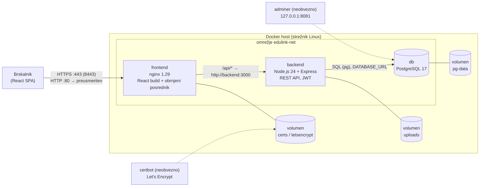

# Arhitektura sistema

EduLink je sestavljen iz treh vsebnikov, ki jih upravlja Docker Compose ([docker-compose.yml](../docker-compose.yml)).
Samo nginx je dosegljiv iz omrežja; baza in backend sta v zasebnem Docker omrežju `edulink-net`.



## Vsebniki

| Storitev | Slika | Naloga | Dostopnost |
|---|---|---|---|
| `frontend` | `nginx:1.29-alpine` (gradnja iz `edulink-vite/Dockerfile`) | postreže React aplikacijo prek HTTPS, `/api/` posreduje backendu, HTTP preusmeri na HTTPS | vrata 8080 (HTTP) in 8443 (HTTPS) |
| `backend` | `node:24-alpine` (`backend/Dockerfile`) | REST API, avtentikacija (JWT), avtorizacija po vlogah, shranjevanje datotek | samo v omrežju `edulink-net` (vrata 3000) |
| `db` | `postgres:17-alpine` | relacijska baza | samo v omrežju; na računalniku `127.0.0.1:5433` za razvoj |
| `adminer` | `adminer:4` (profil `tools`) | spletno orodje za pregled baze | `127.0.0.1:8081` |
| `certbot` | `certbot/certbot` (profil `letsencrypt`) | pridobitev in obnova certifikata Let's Encrypt | – |

Backend začne šele, ko je baza zdrava (`depends_on: service_healthy`), frontend pa, ko je zdrav backend (`/api/health`).

## Podatki in datoteke

- **Baza**: volumen `pg-data`. Shema in testni podatki se ustvarijo ob prvem zagonu iz `PB/schema.sql` in `PB/insert.sql`.
- **Naložene datoteke** (gradiva, oddaje): volumen `uploads` (`/data/uploads` v backendu). Mapa ni javno dostopna; datoteke se
  vrnejo samo prek API-ja po preverjanju prijave in pravic (`GET /api/materials/:id/file`, `GET /api/submissions/:id/file`).
  Oddane naloge so shranjene kot `oddaje/<id naloge>/Priimek Ime – Naslov naloge.končnica`.
- **Certifikati**: volumen `certs` (samopodpisan certifikat za razvoj) oziroma `letsencrypt` (pravi certifikat).
- **Skrivnosti**: v datoteki `.env` (ni v repozitoriju): `JWT_SECRET`, `POSTGRES_PASSWORD`.

## Plasti backenda

```
routes/      HTTP poti, preverjanje vnosa in pravic (assertTeaches, enrolled, requireRole)
lib/         pomožne funkcije: dostop do predmetov, datoteke, gesla (PBKDF2-SHA256), preslikava vrstic v JSON
middleware/  avtentikacija (JWT, vloga se prebere iz baze ob vsaki zahtevi), nalaganje datotek (multer)
db.js        povezava (pg Pool), transakcije, inicializacija sheme
config.js    nastavitve iz okolja (.env)
```

## Avtorizacija

| Vloga | Dovoljeno |
|---|---|
| Administrator | CRUD predmetov, učiteljev in učencev, dodeljevanje predmetov, statistika |
| Učitelj | gradiva (nalaganje, brisanje), naloge, oddaje in ocene samo pri predmetih, ki jih poučuje |
| Učenec | registracija, profil, izbira predmetov, gradiva in naloge vpisanih predmetov, oddaja nalog |

Pravice se preverjajo v backendu pri vsaki zahtevi; skrivanje gumbov v vmesniku ni varnostni ukrep.
