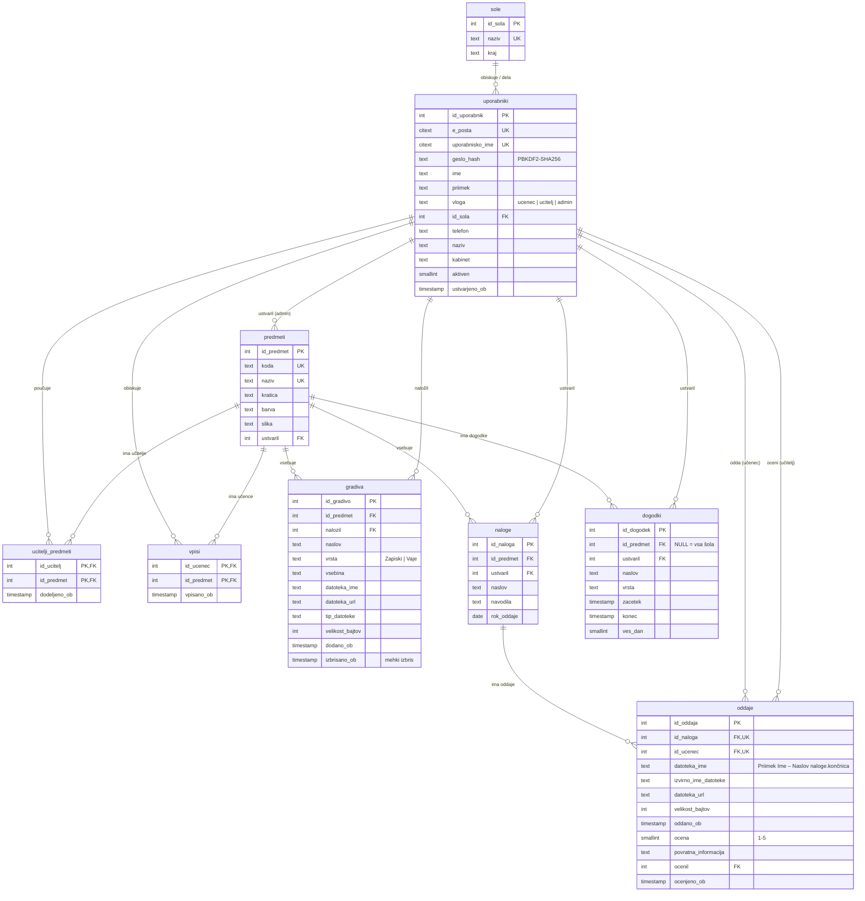

# ER diagram podatkovne baze

Shema je v [PB/schema.sql](../PB/schema.sql) (PostgreSQL). Diagram se izriše na GitHubu in v večini urejevalnikov Markdown.

## Pojasnila

- **Vloge** (`uporabniki.vloga`): `ucenec`, `ucitelj`, `admin`. Vloge so v eni tabeli, ker imajo skupne atribute
  (prijava, ime, e-naslov); razlike obravnavajo omejitve in sprožilci.
- **Razmerja M:N** so razrešena z vmesnima tabelama `ucitelji_predmeti` (predmet ima lahko več učiteljev, učitelj poučuje
  več predmetov) in `vpisi` (učenec obiskuje več predmetov). Sestavljeni primarni ključ prepreči dvojne vnose.
- **Sprožilci** zagotavljajo pravila, ki jih `CHECK` ne more izraziti: v `ucitelji_predmeti` je lahko samo učitelj,
  v `vpisi` samo učenec, oddajo pa lahko ustvari samo učenec, vpisan v predmet naloge.
- **Ena oddaja na učenca in nalogo** (`UNIQUE (id_naloga, id_ucenec)`); ponovna oddaja zamenja obstoječo (po potrditvi učenca).
- **Brisanje**: ob izbrisu predmeta se kaskadno izbrišejo gradiva, naloge, oddaje, vpisi in dodelitve; pri avtorjih
  (`ustvaril`, `nalozil`, `ocenil`) se ob izbrisu uporabnika vrednost postavi na `NULL` (`ON DELETE SET NULL`).
  Gradiva se brišejo mehko (`izbrisano_ob`).
- Shema je v tretji normalni obliki: vsi neključni atributi so odvisni samo od primarnega ključa svoje tabele
  (šola in predmet imata lastni tabeli, ne ponavljata se v zapisih uporabnikov in nalog).
- **Pogleda**: `koledar` (roki nalog in dogodki) ter `pregled_oddaj` (stanje naloge za vsakega vpisanega učenca).
